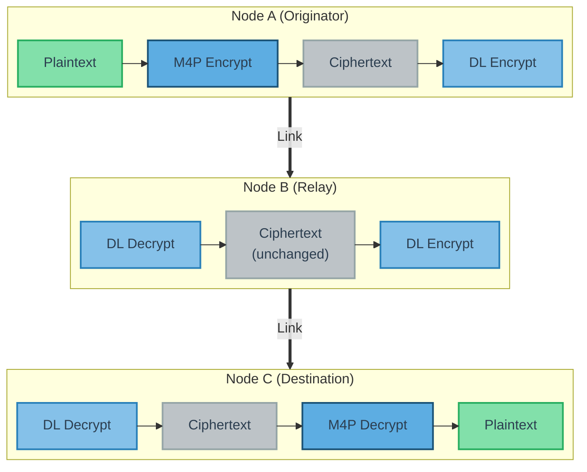
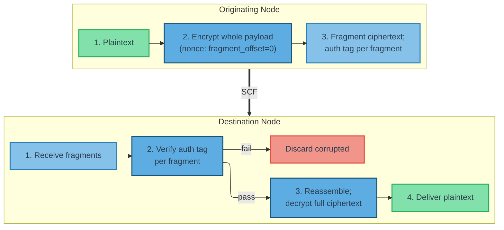

<!--
Copyright (c) 2026 Poseidon's Forge, Inc. All rights reserved.

This work is licensed under the Creative Commons Attribution 4.0
International License. To view a copy of this license, visit
https://creativecommons.org/licenses/by/4.0/

You are free to share (copy and redistribute) and adapt (remix, transform,
and build upon) this material in any medium or format for any purpose,
including commercial, under the following terms:
- Attribution: You must give appropriate credit to Poseidon's Forge, Inc.,
  provide a link to the license, and indicate if changes were made.
-->

## 12. Encryption and Security {#12-encryption-and-security}

**[WIRE FORMAT + BEHAVIORAL]**

This section defines M4P's two-layer security model. Because store-carry-forward relays must read headers for forwarding and deduplication, payload confidentiality is applied end-to-end via the optional M4P payload cipher while DataLink adapters apply per-hop link protection. The layers are independent and complementary. The payload cipher uses AES-CTR with zero ciphertext expansion, preserving payload budget on constrained links.

Figure 12 shows this interaction across a three-node path.



**Figure 12 — M4P Two-Layer Encryption Architecture**

*DL = DataLink-layer encryption (TLS / IPsec / COMSEC). Originator: M4P encrypt + DL encrypt; relay: DL decrypt/re-encrypt only; destination: DL decrypt + M4P decrypt. Node B is a relay without the PSK. A relay that holds the PSK may also re-encode a payload for a compressed link ([Section 12.3.3](#1233-gateway-and-bridge-behavior)).*

### 12.1 Responsibility Summary

The following table summarizes the division of security responsibilities across protocol layers.

| Responsibility | Owner |
|---|---|
| Application payload encryption/decryption | M4P transport (when PSK is configured) |
| Authentication tag computation/verification | M4P transport (when enabled) |
| Nonce derivation | M4P transport (from its own header fields) |
| NC message payloads | Not encrypted |
| Identity obfuscation (UID obfuscation) | Application (see [Section 12.5](#125-identity-obfuscation)) |
| Link-layer encryption (TLS, IPsec, etc.) | DataLink adapter |
| Key provisioning (PSK, certificates) | Deployment operations |

### 12.2 M4P Payload Cipher

**Configuration.** The payload cipher is controlled by one optional network-wide parameter: **`payload_cipher_key`** (PSK; see [Section 2.4.2](#242-required-configuration-must)). When configured, the transport encrypts outgoing application payloads and decrypts incoming payloads before local delivery. When absent, payloads are carried in the clear. All nodes that host clients and use the payload cipher MUST use the same PSK. Relay-only nodes do not need the PSK and forward ciphertext as opaque bytes. A relay that holds the PSK may re-encode the payloads it relays, and so reads them ([Section 12.3.3](#1233-gateway-and-bridge-behavior)).

**Algorithm.** The payload cipher uses **AES-256-CTR** (Counter mode) as defined in NIST SP 800-38A. Key size: 256 bits (32 bytes). Ciphertext expansion: zero (AES-CTR is a stream cipher mode; the ciphertext is the same length as the plaintext). Padding: none required.

#### 12.2.1 What Is Encrypted

The payload cipher operates on **application message payloads only** (see Figure 12 for the two-layer architecture). The following are NOT encrypted:

- All transport-layer packet header fields: `message_type_id`, `source`, `destination`, `timestamp_24h`, `msg_counter`, `payload_length`, `flags`, and all optional header fields.
- All transmission-level metadata: `node_address_sender`.
- Network control (NC) message payloads (message types 32,000–32,767).

Headers and transmission metadata remain visible so intermediate nodes can perform MIID deduplication, scheduling, TTL checks, forwarding, and fragmentation during store-carry-forward operation.

**Design Note (Non-Normative):** NC payloads remain visible so nodes can process discovery, claim, and conflict state without endpoint payload keys; network-layer convergence stays independent of application payload confidentiality.

#### 12.2.2 Nonce Derivation

AES-CTR requires a unique nonce (IV) for each encrypted payload or fragment. The M4P transport derives the nonce from packet header fields available at both sender and receiver, so nonce bytes are not transmitted:

```text
nonce = AES-CTR-NONCE(network_id, source_ca, timestamp_24h, msg_counter, message_type_id, fragment_offset)
```

**Nonce construction.** The nonce is constructed as a 16-byte (128-bit) value:

```text
+-----------------------------------------------+
| network_id_hash          (4 bytes)             |
+-----------------------------------------------+
| source_ca                (2 bytes, zero-padded)|
+-----------------------------------------------+
| timestamp_24h            (3 bytes)             |
+-----------------------------------------------+
| msg_counter              (1 byte)              |
+-----------------------------------------------+
| message_type_id          (2 bytes)             |
+-----------------------------------------------+
| fragment_offset          (2 bytes)             |
+-----------------------------------------------+
| reserved                 (2 bytes, 0x0000)     |
+-----------------------------------------------+
```

**Nonce Byte-Offset Summary**

| Byte Offset | Field | Size | Description |
|---|---|---|---|
| 0–3 | `network_id_hash` | 4 B | First 4 bytes of `SHA-256(network_id)`. Binds nonce to deployment. |
| 4–5 | `source_ca` | 2 B | Client Address, zero-padded to 2 bytes in 8-bit mode. |
| 6–8 | `timestamp_24h` | 3 B | 17-bit timestamp, zero-padded to 3 bytes. |
| 9 | `msg_counter` | 1 B | 7-bit message counter, zero-padded to 1 byte. |
| 10–11 | `message_type_id` | 2 B | Message type, big-endian. |
| 12–13 | `fragment_offset` | 2 B | Fragment byte offset. `0x0000` for unfragmented messages. |
| 14–15 | `reserved` | 2 B | Set to `0x0000`. |

**AES-CTR counter block.** The 16-octet nonce is the initial 128-bit counter block for AES-CTR encryption of the payload (NIST SP 800-38A). Implementations MUST increment the counter as a single 128-bit big-endian integer, by one per 16-octet cipher block, with octet 15 the least-significant counter octet and octet 0 the most-significant. This convention is mandatory for interoperability: a node that increments differently produces a different keystream and cannot exchange encrypted payloads. Because `payload_length` is a 16-bit field (maximum `65,535` octets, i.e. at most 4,096 cipher blocks), the block counter for a single payload never exceeds `4,095`; it is confined to the two low counter octets (14–15) — the `reserved` octets, which are `0x0000` in the initial block — and never carries into octet 13 (part of `fragment_offset`) or any higher-order nonce octet.

**Response packet nonce fields.** For Response packets, the nonce fields are populated as follows:

| Nonce Field | Response Header Source |
|---|---|
| `source_ca` | The Response's `source` field (the responder's CA) |
| `timestamp_24h` | `timestamp_24h_request` (the original Request's timestamp) |
| `msg_counter` | `msg_counter_request` (the original Request's counter) |

The `(source_ca, timestamp_24h_request, msg_counter_request, message_type_id)` tuple is unique because the transport enforces the one-response-per-request invariant in [Section 6.5](#65-deduplication-rules).

**Nonce uniqueness.** Uniqueness is scoped by the tuple `(network_id_hash, source_ca, timestamp_24h, msg_counter, message_type_id, fragment_offset)`:

| Component | Ensures uniqueness per... |
|---|---|
| `(source_ca, timestamp_24h, msg_counter)` (MIID core) | Message |
| `message_type_id` | Packet class |
| `fragment_offset` | Fragment |
| `network_id_hash` | Deployment |

Under correct protocol behavior, distinct plaintexts do not reuse the same key and nonce tuple. The nonce does not depend on the payload form or on `payload_length`: every form and length of one message shares one nonce, and the payload keys of [Section 12.7](#127-payload-form-keys) keep them apart.

**24-hour wrap behavior.** Because `timestamp_24h` wraps every 24 hours, long-lived periodic traffic repeats nonce tuples daily (aperiodic traffic has lower alignment risk).

Deployments that use the payload cipher MUST mitigate nonce reuse with time-based epoch rotation that meets [Section 12.7.6](#1276-epoch-rotation-requirement), deriving short-lived epoch keys from the master PSK as described in [Section 12.4.1](#1241-payload-cipher-key) and [Section 12.4.3](#1243-key-rotation).

**Timing jitter (secondary).** Periodic publishers SHOULD also add small random jitter (seconds) to transmission timing to avoid deterministic timestamp alignment across days. Jitter does not replace epoch rotation: every form of a message shares its nonce, and a held message is re-encrypted at send time ([Section 12.7.6](#1276-epoch-rotation-requirement)).

#### 12.2.3 Authentication Tag

The M4P transport MAY append an authentication tag (4, 8, or 16 bytes) to encrypted payloads. Applications request tagging per message by setting `AUTH_TAG_SIZE` to a non-zero value. The node that encrypts or fragments a packet computes its tag; a node that would deliver the message verifies it before client delivery. A node that computes a new tag for a message it received MUST first verify the received tag ([Section 12.7.3](#1273-tag-keys)).

**[GUIDANCE] Deployment policy.** Deployments with elevated integrity requirements SHOULD tag all messages. Command-and-control and safety-critical traffic SHOULD use `AUTH_TAG_SIZE = 10` or `11` (8- or 16-byte tags). Constrained telemetry MAY use `AUTH_TAG_SIZE = 01` (4-byte tags).

**Tag computation.** Tags use AES-CMAC (NIST SP 800-38B), truncated to N bytes based on `AUTH_TAG_SIZE`:

| `AUTH_TAG_SIZE` | N (tag bytes) |
|---|---|
| `01` | 4 |
| `10` | 8 |
| `11` | 16 |

```text
tag = TRUNCATE_N(AES-CMAC(key, nonce || header_aad || ciphertext))
```

`key` is the packet's tag key ([Section 12.7.3](#1273-tag-keys)): the active key for a plain packet, and the compressed tag key of the message's type for a compressed packet. `nonce` is the 16-byte value from [Section 12.2.2](#1222-nonce-derivation), and `header_aad` is immutable non-encrypted header data in wire order.

**Header AAD construction.** The `header_aad` fields depend on the packet class:

| Packet Class | `header_aad` Fields |
|---|---|
| Status | `flags` (1 byte) ‖ [`carriage` (1 byte)] ‖ `payload_length` (2 bytes) |
| Event | `flags` (1 byte) ‖ [`carriage` (1 byte)] ‖ `payload_length` (2 bytes) |
| Request | `destination` (1 or 2 bytes) ‖ `flags` (1 byte) ‖ [`carriage` (1 byte)] ‖ [`additional_dest_count` (1 byte) ‖ `additional_dest[]` (`additional_dest_count` × CA width)] ‖ `payload_length` (2 bytes) |
| Response | `destination` (1 or 2 bytes) ‖ `payload_length` (2 bytes) ‖ `timestamp_24h_response` (17 bits) ‖ `flags` (7 bits) — packed into 3 bytes ‖ [`carriage` (1 byte)] |

Packet class is determined from `message_type_id` ranges (see [Section 4.1](#41-message-type-id-ranges)), so sender and receiver agree on AAD shape. In every class the `carriage` byte ([Section 5.7.6](#576-optional-field-definitions)) follows `flags` directly and is present only when `CARRIAGE_PRESENT` is set. For Request packets, the bracketed destination-list fields are present only when `ADDITIONAL_DEST_PRESENT` is set. Because `flags` is authenticated, tampering with the presence of either field invalidates the tag. The carriage byte is authenticated so that neither the modality mask nor the `PLAIN` bit, which selects the payload key and the tag key ([Section 12.7](#127-payload-form-keys)), can be rewritten in transit undetected. No node changes the mask bits, so authenticating them costs nothing.

`header_aad` fields are authenticated but not encrypted.

When `AUTH_TAG_SIZE != 00`, the tag appears as an optional field after all other optional fields and before payload (see [Section 5.7.5](#575-optional-field-ordering)). `payload_length` covers ciphertext only and excludes tag bytes. When `AUTH_TAG_SIZE = 00`, the tag field is absent.

**Security strength (guidance).**

| `AUTH_TAG_SIZE` | Tag Length | Forgery Resistance |
|---|---|---|
| `01` | 4 bytes | ~1 in 2^32 per attempt |
| `10` | 8 bytes | ~1 in 2^64 per attempt |
| `11` | 16 bytes | ~1 in 2^128 per attempt (full CMAC strength) |

**Flag bit allocation.** `AUTH_TAG_SIZE` occupies Status bits [7:6], Event bits [7:6], Request bits [7:6], and Response bits [6:5]. Event bit 4 is reserved in this protocol version. **[Section 5.7](#57-flags-and-optional-fields) is authoritative** for bit positions. The field MUST be non-zero only when the payload cipher is active (PSK configured). If a node without a PSK receives a packet where `AUTH_TAG_SIZE != 00`, it MUST forward the packet unchanged.

#### 12.2.4 Transport Pipeline

The payload cipher is applied by the node that encodes a payload form for sending — the origin, or a relay that compresses ([Section 9.11.5](#9115-re-encoding-at-relays)) — and by the node that delivers the message. A relay that only forwards performs no cryptographic operation on the payload.

**Originating node (encryption).** When a client sends a message and a PSK is configured:

1. The client submits the plain payload, optionally setting `AUTH_TAG_SIZE`. The transport validates it ([Section 9.11.4](#9114-submit-validation)) and stores the message.
2. When the transport sends the message on a link, it takes the payload form chosen for that link ([Section 9.11.3](#9113-form-selection-per-link)), constructs the packet header fields and the 16-byte nonce, and derives that form's payload key from the current epoch ([Section 12.7](#127-payload-form-keys)).
3. The transport encrypts the whole payload of that form with AES-CTR.
4. If `AUTH_TAG_SIZE != 00`, the transport computes the authentication tag over `nonce || header_aad || ciphertext` under the form's tag key and places it in the optional-field area.

If fragmentation is required, ordering is defined in [Section 12.2.5](#1225-fragmentation-interaction): encrypt first, then fragment, with per-fragment tags when enabled.

**Destination node (decryption).** When a packet is for local delivery and a PSK is configured:

1. If `AUTH_TAG_SIZE != 00`, reconstruct `header_aad` and nonce, select the tag key from the `PLAIN` bit ([Section 12.7.5](#1275-receiver-key-selection)), verify the tag, and on mismatch MUST discard the packet (or fragment).
2. For fragmented messages, reassemble verified fragments of one form to reconstruct its full ciphertext.
3. Derive the form's payload key, reconstruct the nonce with `fragment_offset = 0`, decrypt with AES-CTR, decode a compressed payload ([Section 9.11.1](#9111-compressed-encoding)), and deliver.

**Intermediate nodes (forwarding).** A relay without the PSK stores, schedules, and forwards ciphertext as opaque bytes. A relay that holds the PSK forwards ciphertext unchanged too, except when it re-encodes a message for a compressed link: it verifies the received tag, decrypts, produces the compressed form, encrypts it under the current epoch, and computes a new tag ([Section 9.11.5](#9115-re-encoding-at-relays)). Such a relay reads the payloads it re-encodes.

**NC bypass.** Network control messages (types 32,000–32,767) bypass this pipeline and are not encrypted.

**Exception: fragmentation and re-fragmentation.** Splitting ciphertext itself requires no cryptographic operation. However, when `AUTH_TAG_SIZE != 00`, any node that creates new fragments MUST compute fresh per-fragment tags (see [Section 12.2.5](#1225-fragmentation-interaction)), which requires the PSK and, for a compressed packet, the type identity of its message type ([Section 12.7.3](#1273-tag-keys)). Nodes without the PSK MUST NOT fragment or re-fragment authenticated packets, and nodes without the type identity MUST NOT fragment or re-fragment authenticated compressed packets of that type; such oversized packets are skipped on that link.

#### 12.2.5 Fragmentation Interaction

When a message is fragmented (see [Section 8](#8-fragmentation-and-reassembly)), each fragment has its own `fragment_offset`; because `fragment_offset` is part of the nonce, each fragment has a distinct nonce.

Canonical ordering is:

1. Encrypt the whole payload of one form using the nonce with `fragment_offset = 0` and that form's payload key ([Section 12.7.1](#1271-key-derivation)). For the compressed form the key depends on the payload's total length.
2. Fragment the ciphertext as needed (including intermediate-node fragmentation or re-fragmentation; see [Section 8.3.2](#832-who-may-fragment)). Fragments are byte slices of that one ciphertext.
3. If `AUTH_TAG_SIZE != 00`, compute a per-fragment tag under the form's tag key ([Section 12.7.3](#1273-tag-keys)) using that fragment's nonce (`fragment_offset = <byte_offset>`), `header_aad`, and ciphertext slice; place the tag in each fragment header. Every fragment carries the same `AUTH_TAG_SIZE` value as the original message.
4. If `AUTH_TAG_SIZE != 00`, verify each fragment tag as fragments arrive and discard failures.
5. Reassemble verified fragments of one form to reconstruct its full ciphertext ([Section 8.4](#84-reassembly)).
6. Derive the form's payload key — for the compressed form from the total length, now known — and decrypt the reassembled ciphertext using the nonce with `fragment_offset = 0`.

`header_aad` MUST be derived from each fragment's own header fields; fragment-specific `flags`, `carriage` and `payload_length` are included in that fragment's AAD. Per-fragment authentication allows immediate rejection of tampered fragments before reassembly.

A node that fragments a form it encrypted MUST slice every fragment of that form and length from the same ciphertext for as long as it holds the record, even after the epoch changes. A node that holds the PSK (and, for the compressed form, the type identity) can re-slice a received ciphertext without decrypting it. It tags the new fragments under the epoch whose key verified the received tag, because the receiver derives the payload key from that same epoch ([Section 12.7.5](#1275-receiver-key-selection)).

Figure 13 illustrates the encrypt-then-fragment and verify-then-reassemble-then-decrypt ordering at the originating and destination nodes.



**Figure 13 — Fragmentation and Encryption Interaction**

**Note:** Implementations MAY decrypt per fragment by adjusting the AES-CTR counter to the fragment offset, but whole-message decrypt after reassembly is RECOMMENDED.

### 12.3 DataLink-Layer Encryption

**[GUIDANCE]**

#### 12.3.1 Role

DataLink-layer encryption provides **per-hop confidentiality and integrity** on individual link segments. It is the responsibility of each DataLink adapter and operates below the M4P transport layer. The transport layer is unaware of whether a DataLink encrypts its transmissions.

DataLink-layer encryption complements the M4P payload cipher (see Figure 12 for the two-layer interaction across a multi-hop path):

**M4P Payload Cipher vs. DataLink-Layer Encryption**

| Property | M4P Payload Cipher | DataLink Layer |
|---|---|---|
| Scope | Originating node to destination node | Per-hop (single link segment) |
| Confidentiality | Yes (AES-CTR) | Yes (when using TLS, IPsec, etc.) |
| Integrity / Authentication | Optional (4/8/16-byte auth tag per `AUTH_TAG_SIZE`) | Yes (when using TLS, IPsec, etc.) |
| Header protection | No (headers in the clear) | Yes (entire transmission encrypted) |
| What is protected | Application message payloads only | All M4P data including headers and NC messages |
| Intermediate node involvement | None without the PSK — ciphertext forwarded as-is; a relay with the PSK may re-encode for a compressed link | Each hop encrypts/decrypts |
| Key source | Master PSK → HKDF epoch derivation | Per-modality provisioning |
| Key rotation | Epoch-based (e.g., 6–12 hours) | Modality-specific procedures |
| Transition window | Accept current + previous key | N/A (per-hop, immediate) |
| Relay nodes need key? | No to forward ciphertext as-is; yes to compress onto a compressed link | Yes — per-hop encrypt/decrypt |
| Independence | Not derived from DataLink keys | Not derived from M4P PSK |

#### 12.3.2 Recommended DataLink Security by Modality

Deployments SHOULD enable DataLink-layer encryption on IP-based links, which are typically the easiest to intercept or inject.

- **IP/MQTT.** SHOULD use TLS 1.2+ with mutual authentication (client certificates). This protects all M4P traffic on that hop (including headers and NC payloads), authenticates peers and broker, and mitigates man-in-the-middle attacks on IP networks. TLS overhead is below M4P and does not consume M4P payload budget.
- **LAN.** SHOULD use IPsec (ESP) or equivalent link protection (for example, WireGuard or MACsec). This protects confidentiality and integrity on the LAN segment; overhead is at the IP/link layer, not the M4P payload budget.
- **Acoustic.** Link-layer encryption is often unavailable. The M4P payload cipher provides payload confidentiality, and integrity-sensitive traffic SHOULD set `AUTH_TAG_SIZE != 00` (see [Section 12.2.3](#1223-authentication-tag)). If modem-native link encryption exists, it SHOULD be enabled as an additional layer.
- **Radio.** SHOULD enable radio COMSEC or waveform-provided encryption when available. If unavailable, the M4P payload cipher still protects payload confidentiality.
- **Satellite.** SHOULD use TLS or DTLS when the terminal provides IP transport. Proprietary terminal encryption MAY provide an additional layer when available.

#### 12.3.3 Gateway and Bridge Behavior

When a node bridges traffic between modalities with different DataLink-layer encryption capabilities, DataLink-layer encryption and decryption are handled independently by each DataLink adapter at each hop. What the bridge does with the M4P payload depends on what it holds.

**A bridge without the PSK never modifies M4P ciphertext.** It:

1. Receives a transmission on one DataLink (e.g., LAN with IPsec). The DataLink adapter decrypts at the link layer, yielding M4P packets with encrypted payloads.
2. Stores the packets in the local message store (payload ciphertext intact).
3. When a transmission opportunity arises on another DataLink (e.g., acoustic), packs the packets into a transmission. The acoustic DataLink transmits them — the payload ciphertext is unchanged.

No re-encryption, tag stripping, or modality-aware crypto logic is required.

**A bridge with the PSK may re-encode.** A bridge that holds the PSK and the type's definition compresses a message it puts onto a compressed link ([Section 9.11.5](#9115-re-encoding-at-relays)): it verifies the received tag, decrypts, encodes the compressed form, encrypts it under the current epoch with the key of [Section 12.7](#127-payload-form-keys), and computes a new tag. A later revision also lets such a bridge degrade relayed Status messages. A bridge that re-encodes therefore reads the payloads it relays; it is inside the deployment's trust domain ([Section 12.6.2](#1262-what-this-model-does-not-provide)). It never produces the plain form from a compressed one.

**A bridge without a type's identity** ([Section 12.7.2](#1272-type-identity)) forwards that type's compressed packets as received. On an encrypted network it cannot re-fragment them when they are tagged, because each new fragment needs a tag keyed by the type identity. It still re-fragments plain packets when it holds the PSK.

### 12.4 Key Management

#### 12.4.1 Payload Cipher Key

The M4P payload cipher uses the deployment PSK (see [Section 2.4.2](#242-required-configuration-must)). PSK provisioning is outside this specification and handled by deployment operations.

All nodes that host clients producing or consuming messages MUST use the same PSK. Relay-only nodes (no hosted clients) do not need the PSK and forward ciphertext as opaque bytes. A node with a compressed link SHOULD hold the PSK and the message catalog so that it can compress what it relays ([Section 9.11.5](#9115-re-encoding-at-relays), [Appendix C.3](#c3-payload-forms-and-catalogs)). Every node that holds the PSK can read every payload it relays.

**Epoch keys.** A deployment that uses the payload cipher MUST treat the provisioned PSK as a **master key** from which short-lived **epoch keys** are derived using a key derivation function (KDF), and MUST rotate them on a time-based schedule that meets [Section 12.7.6](#1276-epoch-rotation-requirement).

**[GUIDANCE] Epoch key derivation.** A RECOMMENDED approach:

```text
epoch_key = HKDF-Expand(
    PRK    = master_psk,
    info   = "M4P-epoch" || network_id || epoch_number,
    L      = 32  (AES-256 key length)
)
```

`epoch_number` is a monotonically increasing epoch identifier (for example from UTC hours, mission phase, or a deployment schedule). The derived epoch key is used as `payload_cipher_key` for that epoch and avoids nonce reuse across epoch boundaries (see [Section 12.2.2](#1222-nonce-derivation), *24-hour wrap behavior*). This assumes the master PSK is uniformly random 256-bit key material; if it comes from a passphrase or other low-entropy source, implementations SHOULD apply HKDF-Extract first (RFC 5869) before HKDF-Expand.

A deployment that uses the master PSK directly, without epoch rotation, does not meet [Section 12.7.6](#1276-epoch-rotation-requirement) and reuses keystream across the 24-hour wrap described in [Section 12.2.2](#1222-nonce-derivation), *24-hour wrap behavior*.

See [Section 12.3.1](#1231-role) for a comparison of the M4P payload cipher and DataLink-layer encryption, including key management properties.

#### 12.4.2 Key Scope

The PSK is scoped to a deployment (network ID). Different deployments SHOULD use different keys. Combined with the `network_id_hash` in the nonce, this ensures that ciphertext from one deployment is not decryptable with another deployment's key, even if message header fields happen to collide.

#### 12.4.3 Key Rotation

Key rotation (epoch derivation in [Section 12.4.1](#1241-payload-cipher-key) or manual PSK replacement) requires DTN-aware coordination because nodes may not transition simultaneously.

**Transition window.** During the period between one node adopting a new epoch key and the last node transitioning:

- Nodes SHOULD accept decryption attempts with both the current and previous epoch key.
- If decryption with the current key fails and a previous key is available, the node SHOULD attempt decryption with the previous key before discarding the payload.
- Nodes MUST retain previous keys for at least the maximum configured message TTL to decrypt in-flight messages created under a prior epoch.

**Epoch synchronization.** For time-based derivation, all nodes derive from the same master PSK and epoch schedule. Sub-second agreement is unnecessary; nodes only need to agree on the current epoch. Deployments MUST choose a rotation period that meets [Section 12.7.6](#1276-epoch-rotation-requirement) — at most 16 hours with the maximum encodable TTL — and SHOULD use 12 hours, which also tolerates clock drift and DTN propagation delay. A 6-hour period also meets the requirement.

**Scheduling guidance.** Deployments SHOULD minimize the transition window by placing epoch boundaries during high-connectivity periods (for example, surfaced operations or LAN availability).

The nonce's `reserved` octets (14–15) are the low octets of the AES-CTR counter ([Section 12.2.2](#1222-nonce-derivation)). They stay `0x0000` in the initial counter block and do not carry a key epoch identifier.

#### 12.4.4 DataLink-Layer Keys

DataLink-layer key management is modality-specific:

- **MQTT/TLS:** X.509 certificates or PSK, managed per standard TLS provisioning practices.
- **IPsec:** Pre-shared keys or certificates, managed per standard IPsec/IKE provisioning.
- **Radio COMSEC:** Managed per the radio system's key management procedures.
- **Satellite:** Managed per the satellite terminal's security provisioning.

DataLink-layer keys are independent of the M4P payload cipher PSK.

### 12.5 Identity Obfuscation

NodeUIDs and ClientUIDs are opaque strings from M4P's perspective: transport and network logic do not interpret UID content. Applications MAY provide obfuscated UIDs (for example, pseudonyms instead of `vehicle-123`), and M4P uses them unchanged for address derivation, NC payloads, and conflict handling. This preserves protocol behavior while reducing identity exposure in NC traffic, which is not encrypted by the payload cipher.

Identity obfuscation is an application-layer responsibility. M4P does not define the mechanism, but all nodes in a deployment MUST apply the same scheme so the same logical identity maps to the same obfuscated UID. Deployments in contested environments SHOULD obfuscate all NodeUIDs and ClientUIDs (for example, HMAC-based pseudonymization) to reduce passive fleet enumeration.

### 12.6 Security Properties and Limitations

#### 12.6.1 What This Model Provides

- **Payload confidentiality from originating node to destination node** across all modalities, against every node that does not hold the PSK. Intermediate forwarding nodes without the PSK cannot access plaintext payloads. A relay that holds the PSK can, and re-encodes payloads for compressed links ([Section 12.3.3](#1233-gateway-and-bridge-behavior)).
- **Per-message payload integrity and authentication** via the optional authentication tag (`AUTH_TAG_SIZE`: 4, 8, or 16 bytes).
- **Per-hop integrity and confidentiality** on IP-based links (LAN, MQTT) via standard link-layer security (TLS, IPsec).
- **Defense in depth:** The M4P payload cipher and DataLink-layer encryption operate independently. Compromise of one layer does not compromise the other.
- **Transparent bridging:** Gateway nodes without the PSK forward ciphertext payloads without cryptographic awareness or processing.
- **Transparent to applications:** Clients publish and subscribe as usual; M4P transport handles cryptographic operations when PSK is configured.

#### 12.6.2 What This Model Does Not Provide

- **Application-to-application confidentiality.** Originating and destination M4P transports see plaintext payloads. Applications that require confidentiality from M4P SHOULD encrypt payloads before submission. Such a payload has no compressed form and travels in the plain form on every link.
- **Confidentiality from relays that hold the PSK.** A relay that holds the PSK can decrypt every payload it relays, and one with a compressed link does so to compress ([Section 12.3.3](#1233-gateway-and-bridge-behavior)).
- **Header confidentiality (end-to-end).** Transport headers (source/destination CA, message type, timestamps, payload length) remain in the clear; observers can infer communication patterns. DataLink encryption protects headers per-hop on supported links, not end-to-end.
- **Protection against traffic analysis.** Even with the payload cipher and DataLink-layer encryption, packet sizes, timing, and addressing patterns are observable. M4P does not provide traffic flow confidentiality.
- **NC message payload confidentiality (end-to-end).** NC payloads containing NodeUIDs and ClientUIDs are not encrypted by the payload cipher; they rely on DataLink-layer encryption where available. Identity obfuscation (see [Section 12.5](#125-identity-obfuscation)) mitigates passive exposure.

**Design Note (Non-Normative): Threat model alignment.** This model targets autonomous maritime deployments where fleet nodes share a trust domain. Every node that holds the PSK is inside that trust domain: it can read, re-encode and re-tag the payloads it relays. Primary threats and mitigations:

- **Passive IP eavesdropping:** Mitigated by DataLink-layer TLS/IPsec plus the M4P payload cipher.
- **Active IP interception/injection:** Mitigated by DataLink mutual authentication and integrity protections.
- **Passive acoustic eavesdropping:** Mitigated by the M4P payload cipher.
- **Active acoustic tampering:** Mitigated when `AUTH_TAG_SIZE != 00` is used (see [Section 12.2.3](#1223-authentication-tag)).

**Standards alignment.** M4P specifies AES-256-CTR (NIST SP 800-38A) and AES-CMAC (NIST SP 800-38B). Deployments requiring FIPS 140-2/3 assurances SHOULD use validated modules. Independent payload-cipher and DataLink layers support defense in depth (for example, CSfC). AES-256 satisfies CNSA 2.0 symmetric baseline requirements.

### 12.7 Payload Form Keys {#127-payload-form-keys}

<!-- PSFI-3515 (per-link compression) section drafted by a Claude agent; supersedes the unmerged representation-keying section of m4p-spec PR #1. -->

An application payload travels in one of two forms ([Section 9.11](#911-payload-forms)): the **plain form**, the protobuf bytes the origin's client submitted, or the **compressed form**, the type's full DCCL encoding or one of its degraded rungs. The nonce ([Section 12.2.2](#1222-nonce-derivation)) is derived only from identity header fields, so every form and every length of one message share one nonce. AES-CTR requires distinct plaintexts under one nonce to use distinct keys, otherwise they reuse keystream. This section derives one payload key for the plain form and one per type identity and total length for the compressed form, and a tag key for each form. It applies to every application payload whenever the payload cipher is active, fragmented or not.

#### 12.7.1 Key Derivation {#1271-key-derivation}

```text
plain_key = HKDF-Expand(
    PRK  = <active payload cipher key>,
    info = "M4P-plain",
    L    = 32)

compressed_key = HKDF-Expand(
    PRK  = <active payload cipher key>,
    info = "M4P-comp" || type_identity || total_length_be16,
    L    = 32)
```

- **`"M4P-plain"`** is the 9-octet ASCII string `M4P-plain`; **`"M4P-comp"`** is the 8-octet ASCII string `M4P-comp`.
- **`type_identity`** is the 32-octet identity of the message's type ([Section 12.7.2](#1272-type-identity)).
- **`total_length_be16`** is the length of the whole compressed payload as two big-endian octets: the `payload_length` of an unfragmented packet, or the length of the reassembled payload of a fragmented one. The `info` string is 42 octets.

**One ciphertext per form and length.** The sender encrypts the whole payload of one form and length once, with the nonce at `fragment_offset = 0` and that form's key, and every fragment is a byte slice of that ciphertext ([Section 12.2.5](#1225-fragmentation-interaction)). A receiver derives the compressed key after reassembly, when the total length is known. A node that holds the PSK and the type identity can therefore re-slice a received compressed ciphertext without decrypting it.

**HKDF-SHA-256 is pinned.** Payload form keys MUST use HKDF ([RFC5869]) with SHA-256. Every node derives these keys independently from cleartext header fields with no negotiation, so the construction is fixed network-wide. The KDF and hash latitude of epoch key derivation ([Section 12.4.1](#1241-payload-cipher-key)) does not extend to payload form keys.

**PRK provenance.** `PRK` is the active payload cipher key: the epoch key of the epoch in use when epoch rotation is configured ([Section 12.4.1](#1241-payload-cipher-key)), or the master PSK when it is not. A node encrypts under the current epoch at send time ([Section 12.7.6](#1276-epoch-rotation-requirement)).

#### 12.7.2 Type Identity {#1272-type-identity}

A message type with a DCCL definition has a **type identity**: SHA-256 over everything that decides its compressed bytes.

```text
type_identity = SHA-256(
    fingerprint                   32 octets
    drop_order_count              uint32, big-endian
    for each drop-order entry, in ladder order:
        path_length               uint32, big-endian
        field_number[path_length] uint32 each, big-endian, root to leaf
        retention_priority        uint8
    compressed_encoding_version   uint32, big-endian)
```

- **`fingerprint`** is the per-type DCCL fingerprint computed by the M4P reference codec (`dccl-rs`, `MessageFingerprint`). It covers what determines the full compressed encoding: field numbers, types and order, DCCL bounds and codec options, the DCCL message id, and the same for every nested message. Names, comments, `max_bytes`, transport priority, TTL and routing or retention annotations do not affect it.
- **The drop order** lists every field that carries a retention priority ([Section 9.11.2](#9112-degraded-rungs)) and is reachable from the message through singular message fields: never through repeated or map fields, and never into a message type already on the path from the root. It is listed in ladder order: ascending retention priority, ties broken by the root-to-leaf field-number path. Field paths are field numbers, so renaming a field does not change the identity.
- **`compressed_encoding_version`** identifies the implementation of [Section 9.11.1](#9111-compressed-encoding) and [Section 9.11.2](#9112-degraded-rungs). An implementation MUST change it whenever a change to its encoder or ladder would change any compressed bytes it produces.

Two nodes that compute the same type identity for a type produce byte-identical compressed forms of the same message ([Section 9.11.2](#9112-degraded-rungs)). A type with no DCCL definition has no type identity and only the plain form.

#### 12.7.3 Tag Keys {#1273-tag-keys}

```text
plain_tag_key      = <active payload cipher key>

compressed_tag_key = HKDF-Expand(
    PRK  = <active payload cipher key>,
    info = "M4P-comp-tag" || type_identity,
    L    = 32)
```

`"M4P-comp-tag"` is the 12-octet ASCII string `M4P-comp-tag`. The tag is computed and verified as in [Section 12.2.3](#1223-authentication-tag), per packet and per fragment, under the tag key of the packet's form. No wire bytes are added.

- Any node that holds the PSK can verify, re-tag and re-fragment a plain packet, whatever its message catalog.
- Verifying, re-tagging or re-fragmenting a compressed packet also requires the type identity. A node without it MUST treat the tag of a compressed packet as unverifiable: it forwards the packet as received, and MUST NOT re-tag or re-fragment it.
- A compressed packet made under a different type identity fails the tag.
- A node MUST compute a new tag for a message it did not originate, re-encoded or re-sliced, only after that message's inbound tag verified. A node MUST NOT give an unverified packet a valid tag.
- A node that would deliver a message MUST discard a copy whose tag fails. That copy is neither stored nor delivered, and it does not suppress a later copy ([Section 6.5](#65-deduplication-rules)).

#### 12.7.4 Shared Nonce and Counter Discipline {#1274-shared-nonce-and-counter-discipline}

Every form and length of one message is encrypted under the standard nonce ([Section 12.2.2](#1222-nonce-derivation)) with `fragment_offset = 0x0000` and the `reserved` octets (14–15) at `0x0000`. Separation between forms and lengths comes entirely from their keys. Two rules follow:

- **Equal key, equal bytes.** Under one type identity, every node that produces a compressed form of a message of a given total length produces the same bytes ([Section 9.11.2](#9112-degraded-rungs)), and the ladder keeps each rung strictly shorter than the last. A node MUST NOT encrypt two different compressed payloads of one message with equal total length under one type identity.
- **Frozen slices.** A node that fragments a form it encrypted MUST slice every fragment of that form and length from the same ciphertext ([Section 12.2.5](#1225-fragmentation-interaction)).

**Counter discipline.** Octet 15 is the least-significant counter octet ([Section 12.2.2](#1222-nonce-derivation)), so the low nonce octets lie inside the counter's increment region. A per-form discriminator in those octets would put forms on overlapping counter runs and reuse keystream; these keys avoid that by leaving the nonce fixed and varying the key. A 16-bit payload length confines each payload's counter to octets 14–15, so they are `0x0000` in the initial counter block of every form.

#### 12.7.5 Receiver Key Selection {#1275-receiver-key-selection}

A receiver selects both keys from the authenticated header ([Section 12.2.3](#1223-authentication-tag)) and its own message catalog:

```text
if the carriage byte is present and PLAIN is set:
    tag key     = plain_tag_key
    payload key = plain_key
else:
    tag key     = compressed_tag_key(type_identity of message_type_id)
    payload key = compressed_key(type_identity, total length)
```

The carriage byte is part of `header_aad`, so `PLAIN` cannot be flipped without failing the tag. The receiver does not need to know which types are degradable: a degraded rung and the full compressed form differ only in length. A receiver without the type identity of a compressed packet cannot verify or decrypt it, and only forwards it. Trial verification stays at two attempts, the current epoch and then the previous one ([Section 12.4.3](#1243-key-rotation)); the epoch whose key verifies the tag supplies the active key from which the payload key is derived. Untagged traffic follows the same two-epoch trial with no integrity signal.

#### 12.7.6 Epoch Rotation Requirement {#1276-epoch-rotation-requirement}

Every node that encodes a payload form encrypts it under the current epoch at send time: the origin and re-encoding relays alike, including for a message held until late in its TTL. The nonce's `timestamp_24h` is the message's origin time and repeats every 24 hours ([Section 12.2.2](#1222-nonce-derivation)). A message held for its TTL and re-encrypted at the end of it, and another message created 24 hours after the first with the same nonce inputs, are encrypted at most 24 hours minus the TTL apart. They must not fall in one epoch.

A deployment that enables the payload cipher MUST therefore use time-based epoch rotation ([Section 12.4.1](#1241-payload-cipher-key), [Section 12.4.3](#1243-key-rotation)) with a period *P* such that *P* plus the maximum encodable TTL (26,760 s, about 7.4 hours; [Section 5.7.6](#576-optional-field-definitions)) is less than 24 hours: at most 16 hours. A 12-hour period is RECOMMENDED. Timing jitter does not replace epoch rotation, because every form of a message shares its nonce. An implementation SHOULD warn when it is configured with the payload cipher and a period above this bound, and SHOULD NOT refuse to run because of it.

---
